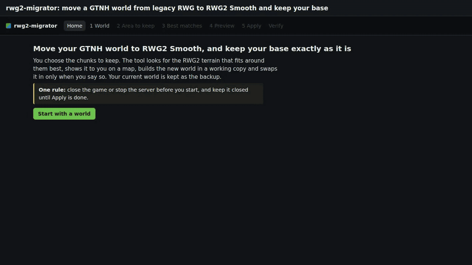

# rwg2-migrator

Move a GT New Horizons world from legacy RWG to RWG2 Smooth while keeping your base exactly as it is.


[](docs/media/demo.mp4)

## Features

- Keep the chunks you choose: import your ServerUtilities claims or paint chunks on a map.
- Search RWG2 for the setting whose terrain fits best around your base, with live maps of each match.
- Preview the migrated world on a copy, with the border smoothed into the new terrain.
- Apply in under a minute. Your old world becomes the backup, and Roll back restores it.
- Works with dedicated servers and single-player saves, through a browser UI or the command line.
- Every long step resumes after an interruption.

## Requirements

- A world made with legacy RWG (the `RWG` world type) on GTNH 2.9.0.
- Windows, or Linux as new as Ubuntu 22.04 or Debian 12 (glibc 2.35), 64-bit. There is no macOS zip.
- 8 GB of RAM (16 GB recommended) and enough disk space for one more copy of your world.
- An internet connection on first use, to download the official GTNH server pack (568 MB) and, if needed, a Java runtime.

## Installation

Download the zip for your system from the [releases page](https://github.com/KatsuKumi/rwg2-migrator/releases), extract
it, and run `rwg2-migrator.exe` (Windows) or `./rwg2-migrator/rwg2-migrator` (Linux). The app opens in your browser. Keep
the console window open while you use it.

## Usage

**Close the game or stop the server before you start, and keep it closed until Apply is done.**

1. **World**: open your server folder, single-player save or world folder.
2. **Area to keep**: import your claims or paint chunks. A one-chunk safety margin is added around them.
3. **Best matches**: start the search, compare the candidates, and pick one.
4. **Preview**: build the migrated world on a copy and check it.
5. **Apply**: replace your world with the preview. The previous world is kept as a backup.
6. **Verify**: check the result, or roll back.

### Command line

```
rwg2-migrator inspect WORLD
rwg2-migrator area WORLD --claims all --margin 1 --out area.json
rwg2-migrator search WORLD --area area.json --accept-eula
rwg2-migrator preview WORLD --area area.json --search JOB --pick N
rwg2-migrator apply WORLD --preview JOB --yes
rwg2-migrator verify WORLD
rwg2-migrator rollback WORLD --yes
```

Without `--yes`, `apply` and `rollback` only show what they would do. On a server, both also need `--auto-restart-off`.
When the config folder is not next to the world, pass it with `--config-dir`. Run `rwg2-migrator COMMAND --help` for all
options.

## How long it takes

| Step | Time |
|---|---|
| Each start of the generator | about 1 to 2.5 minutes (the first start, which also checks the generator, is the longest) |
| Map of your world | half a minute to 3 minutes for 72,000 chunks |
| Best-match search | 15 to 30 minutes, the first search included (it also downloads and sets up the generator) |

The preview takes a few minutes and Apply under a minute. Times depend on your computer and the size of your world.

## After a GTNH update

A GTNH update replaces your `config` folder, which removes the four offset lines from `config/rwg2.cfg`. Without them,
newly generated chunks will not line up with the migrated terrain. After every update, open the tool, run **Verify** and
click **Restore the 4 offset lines**. For a world folder alone, pick the config folder of the server or instance that
runs it on the World screen first.

## FAQ

**My JourneyMap still shows the old terrain outside my base.**
Rename the overworld map folder (DIM0) of this world so it redraws; waypoints are kept. For single player, Apply can do it
for you. VisualProspecting veins stay valid.

**How do I undo the migration?**
Open the world in the tool, go to **Verify** and click **Roll back**. Progress made since Apply is lost.

**My server is on a rented host.**
Stop it and download `World/` and `config/` into an empty folder, side by side. Open that `World` folder in the tool
and tick **I copied this from another machine**; the tool uses the `config` folder next to it. After Apply, delete the
old `World` folder on the host before uploading the new one and the changed config files. The After Apply screen walks
you through it.

**I only have the world folder.**
The tool still migrates it, on GTNH's default RWG2 settings, but it has no `config/rwg2.cfg` to write the four offset lines
into. After Apply it shows them and saves them in `<world>-rwg2-offsets.txt` next to the world. Put them in the
"expert / worldgen migration" section of `config/rwg2.cfg` of the server or instance that will run the world, before it
starts. If you have that config folder, pick it on the World screen (or pass `--config-dir`) instead.

**Can I keep two bases far apart?**
Yes, but RWG2 uses one setting for the whole world, so distant areas make a good match less likely.

**My antivirus removed a file from the GTNH server pack.**
Some GTNH releases include a jar that Windows Defender wrongly flags (GTNH issue #26655). Restore it from Protection
history or allow the tool's cache folder, then try again.

## Building from source

Requires [uv](https://docs.astral.sh/uv/).

```
uv sync --group build
uv run python dev/build.py
uv run pytest
```

## Support

Report bugs and ask questions at https://github.com/KatsuKumi/rwg2-migrator/issues.

## License

GPL-3.0-or-later. Third-party components are listed in [THIRD_PARTY_NOTICES](THIRD_PARTY_NOTICES). The GTNH server pack,
Minecraft and Forge are downloaded from their official sources and are not redistributed.

Built on [RWG2](https://github.com/GTNewHorizons/Realistic-World-Gen-2) and the [GT New Horizons](https://www.gtnewhorizons.com)
server pack. Maps are drawn with [Leaflet](https://leafletjs.com).
